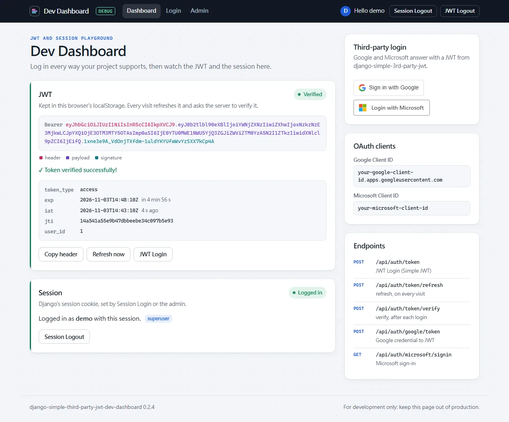
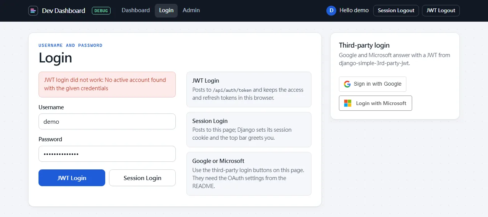
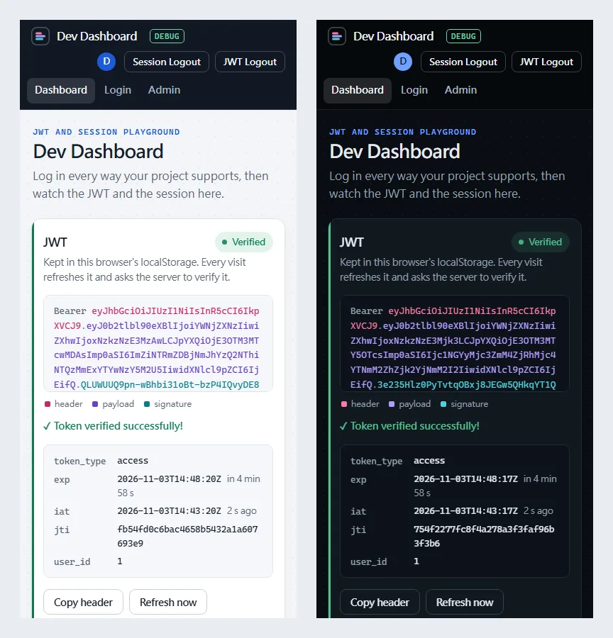

<p align="center">
  <picture>
    <source media="(prefers-color-scheme: dark)" srcset="https://raw.githubusercontent.com/NatLee/django-simple-3rd-party-jwt-dev-dashboard/main/docs/images/dashboard-dark.webp">
    
  </picture>
</p>

<p align="center">
  <a href="https://pypi.org/project/django-simple-third-party-jwt-dev-dashboard/"></a>
  <a href="https://pypi.org/project/django-simple-third-party-jwt-dev-dashboard/"></a>
  <a href="https://www.djangoproject.com/"></a>
  <a href="https://github.com/NatLee/django-simple-3rd-party-jwt-dev-dashboard/actions/workflows/test.yml"></a>
  <a href="https://github.com/NatLee/django-simple-3rd-party-jwt-dev-dashboard/blob/main/LICENSE"></a>
</p>

A hidden developer page for your Django project's login. Sign in with a username and password (as a
session or as a JWT), with Google, or with Microsoft, and watch the dashboard refresh, verify and decode
the token, before you have written a single line of frontend. It is the companion of
[django-simple-3rd-party-jwt](https://github.com/NatLee/django-simple-3rd-party-jwt), which does the
actual "Google / Microsoft account → JWT" work.

> **Development only.** The dashboard shows your OAuth client IDs, its login view skips CSRF checks,
> and it keeps tokens in the browser's `localStorage`. Mount it on a hidden URL and keep it out of
> production, for example by adding its routes only when `DEBUG` is on.

## Try it first (Docker)

No Django project needed: the example project runs in a container.

```bash
git clone https://github.com/NatLee/django-simple-3rd-party-jwt-dev-dashboard.git
cd django-simple-3rd-party-jwt-dev-dashboard/example
docker compose up --build
```

Open <http://localhost:8000/api/__hidden_dev_dashboard/> and log in as `demo` / `demo-pass-123`.
Press <kbd>Ctrl</kbd>+<kbd>C</kbd> to stop it and `docker compose down` to throw it away.

## Installation

```bash
pip install django-simple-third-party-jwt-dev-dashboard
```

Needs Python 3.8+ and Django 4.0+. It also installs Django REST framework and
django-simple-third-party-jwt, which brings Simple JWT. For the optional Swagger and Redoc pages, install
the `docs` extra instead: `pip install "django-simple-third-party-jwt-dev-dashboard[docs]"` (see
[API docs](#api-docs-swagger-and-redoc)).

## Quick start

Three steps in a Django project, for example a new one from `django-admin startproject mysite`.

**1. Settings.** Add this to the end of `settings.py`:

```python
INSTALLED_APPS += [
    "rest_framework",
    "django_simple_third_party_jwt",  # Google and Microsoft login
    "django_simple_third_party_jwt_dev_dashboard",  # this dashboard
]

# Paths without a leading slash
DEV_DASHBOARD_SETTINGS = {
    "dashboard_url": "api/__hidden_dev_dashboard",
    "jwt_token_url": "api/auth/token",
    "jwt_refresh_url": "api/auth/token/refresh",
    "jwt_verify_url": "api/auth/token/verify",
    "admin_url": "admin",  # the navbar's Admin link: your project's admin
}
JWT_3RD_PREFIX = "api"  # Google and Microsoft routes live under /api/auth/...
LOGIN_REDIRECT_URL = "/" + DEV_DASHBOARD_SETTINGS["dashboard_url"]  # where a Microsoft login lands
```

**2. URLs.** Add one line to `urls.py` (a new project's `urls.py` already imports `path`):

```python
from django.urls import include

urlpatterns += [
    path("", include("django_simple_third_party_jwt_dev_dashboard.all_urls")),
]
```

That serves the dashboard, Simple JWT's token, refresh and verify views, and the Google and Microsoft
routes, all at the paths from step 1. Your own `admin/` stays where it is.

**3. Run it:**

```bash
python manage.py migrate
python manage.py createsuperuser
python manage.py runserver
```

Open <http://localhost:8000/api/__hidden_dev_dashboard/> and log in with the user you just created.
Username and password logins work right away; Google and Microsoft need [their settings](#google-and-microsoft-login).

If a path does not line up, `runserver` and `manage.py check` tell you which one and how to fix it
(see [startup checks](#startup-checks)).

## Upgrading from 0.2.x

**Check `INSTALLED_APPS` for `"bootstrap3"` and `"drf_yasg"`.** Neither package is installed with the
dashboard any more, so a fresh install with either one still listed stops with
`ModuleNotFoundError`.

- `"bootstrap3"`: remove it. Keep it (and `pip install django-bootstrap3` yourself) only if your own
  templates use it.
- `"drf_yasg"`: if you want the Swagger and Redoc pages, install the extra,
  `pip install "django-simple-third-party-jwt-dev-dashboard[docs]"`; otherwise remove it.

**If you override the dashboard's templates**, three more things changed:

- The templates moved into the package's own folder, the usual Django layout. Move your overrides the
  same way and update their `` line:

  | 0.2.x | 0.3.0 |
  |---|---|
  | `templates/base.html` | `templates/django_simple_third_party_jwt_dev_dashboard/base.html` |
  | `templates/dashboard.html` | `templates/django_simple_third_party_jwt_dev_dashboard/dashboard.html` |
  | `templates/login.html` | `templates/django_simple_third_party_jwt_dev_dashboard/login.html` |
  | `` | `` |

  An override left at the old name is simply ignored. In return, a `base.html` or `login.html` that
  belongs to your own site no longer replaces the dashboard's pages.
- The pages no longer use Bootstrap or jQuery: they bring their own CSS and plain JavaScript, and jQuery
  is not loaded any more. A `dashboard.html` or `login.html` of yours that relies on Bootstrap classes,
  `` tags or `$` needs those back: load Bootstrap's CSS and jQuery in the
  `extra_head` block (see [Customizing the pages](#customizing-the-pages)), or move it to the new markup.
- `base.html` was rewritten. If you override it, start again from the new one.

Projects that only use the dashboard as it ships need nothing else. Optional clean-ups:

- Drop `SECURE_REFERRER_POLICY = "no-referrer-when-downgrade"` and `SECURE_CROSS_ORIGIN_OPENER_POLICY = None`:
  the dashboard now sends the headers Sign in with Google needs on its own pages, so the rest of your
  project can keep Django's safer defaults.
- Replace the hand-written `path()` lines with the `all_urls` include above.

## What you can try

| Try this | How | Served by |
|---|---|---|
| Session login and logout | **Session Login** on the login page, **Session Logout** in the top bar | this dashboard |
| JWT login | **JWT Login** (or Enter) on the login page; the tokens go to `localStorage` | Simple JWT |
| Refresh and verify | every dashboard visit, or **Refresh now**: the token is refreshed, verified and decoded | Simple JWT |
| Google login | the **Sign in with Google** button | django-simple-3rd-party-jwt |
| Microsoft login | **Login with Microsoft**, which comes back with a JWT | django-simple-3rd-party-jwt |
| JWT logout | **JWT Logout** forgets the stored tokens | your browser |
| Admin, Swagger, Redoc | top bar links, shown while their pages are served | your project; [API docs](#api-docs-swagger-and-redoc) |

Each card says what state it is in (not logged in, checking, verified, rejected) and, when something
fails, what the server answered:



The pages follow your system's light or dark theme and fit a phone screen:



## How it fits with django-simple-3rd-party-jwt

This package only brings pages. The work happens in two other places:

- [Simple JWT](https://django-rest-framework-simplejwt.readthedocs.io/) issues, refreshes and verifies
  tokens for username and password logins.
- [django-simple-3rd-party-jwt](https://github.com/NatLee/django-simple-3rd-party-jwt) turns a Google
  credential or a Microsoft sign-in into the same kind of token pair. It serves
  `/<JWT_3RD_PREFIX>/auth/google/token` and `/<JWT_3RD_PREFIX>/auth/microsoft/...`.

The dashboard is a set of buttons wired to those URLs, so you can see the whole flow working in your
project. Its CSS and plain JavaScript ship inside the package; only Google's Sign-In script and the
Microsoft logo come from the internet.

## Settings

### `DEV_DASHBOARD_SETTINGS`

Paths without a leading slash. The dashboard links to them or calls them from JavaScript; `all_urls`
serves the first four for you.

| Key | What uses it | Quick start value |
|---|---|---|
| `dashboard_url` | where `all_urls` mounts the dashboard, its login and logout | `api/__hidden_dev_dashboard` |
| `jwt_token_url` | the **JWT Login** button | `api/auth/token` |
| `jwt_refresh_url` | the token refresh on every dashboard visit | `api/auth/token/refresh` |
| `jwt_verify_url` | the token check after each login or refresh | `api/auth/token/verify` |
| `admin_url` | the **Admin** link | `admin` |
| `swagger_url` | the **Swagger** page and link, with the `docs` extra | not set |
| `redoc_url` | the **Redoc** page and link, with the `docs` extra | not set |

A top bar link shows only while its page is served: a missing key, or nothing at that path, hides it. If you leave out `DEV_DASHBOARD_SETTINGS` altogether, the
dashboard uses `api/__hidden_dev_dashboard`, `api/auth/token…` as above, plus `api/__hidden_admin`,
`api/__hidden_swagger` and `api/__hidden_redoc` for the three links.

`JWT_3RD_PREFIX` belongs to django-simple-3rd-party-jwt and decides where its Google and Microsoft routes
live. The dashboard's pages find those routes, and their own, by URL name, so they follow wherever the
routes are mounted.

The tokens are kept in `localStorage` under the keys django-simple-3rd-party-jwt's Microsoft login writes
to: its `MICROSOFT_JWT_REDIRECT_ACCESS_TOKEN_KEY` and `MICROSOFT_JWT_REDIRECT_REFRESH_TOKEN_KEY` settings
(`access_token` and `refresh_token` unless you change them).

### Startup checks

When the dashboard's URLs are included, Django's `check` (also run by `runserver` and `migrate`) looks
for setups that cannot work and prints a warning with a hint. Nothing stops the project from starting,
and a project that does not serve the dashboard (say, only while `DEBUG` is on) sees nothing.

| Warning | You see it when |
|---|---|
| `dev_dashboard.W001` | `django_simple_third_party_jwt` is not in `INSTALLED_APPS` |
| `dev_dashboard.W002` | the `django.template.context_processors.request` context processor is missing |
| `dev_dashboard.W003` | a Simple JWT URL is missing from the settings or nothing serves it |
| `dev_dashboard.W004` | the Google and Microsoft routes (`django_simple_third_party_jwt.urls`) are not included |

Silence one you do not care about with `SILENCED_SYSTEM_CHECKS = ["dev_dashboard.W001"]`.

### Google and Microsoft login

These settings belong to django-simple-3rd-party-jwt; the dashboard reads the client IDs to show them
and to set up the Google button.

```python
import os

SOCIAL_GOOGLE_CLIENT_ID = "<your-client-id>.apps.googleusercontent.com"
SOCIAL_MICROSOFT_CLIENT_ID = "<your-application-client-id>"
# Never commit a client secret: read it from the environment
SOCIAL_MICROSOFT_CLIENT_SECRET = os.environ["SOCIAL_MICROSOFT_CLIENT_SECRET"]

# E-mail domains that may sign up through Google or Microsoft
VALID_REGISTER_DOMAINS = ["gmail.com", "hotmail.com"]
```

Without them, django-simple-3rd-party-jwt falls back to its author's demo apps and logs a warning.
Those may stop working at any time, so register your own:

<details>
<summary><b>Get a Google client ID</b></summary>

1. Open [Google Cloud → APIs & Services → Credentials](https://console.cloud.google.com/apis/credentials)
   and create an **OAuth client ID** of type **Web application**.
2. Add `http://localhost` and `http://localhost:8000` to **Authorized JavaScript origins** and to
   **Authorized redirect URIs**.
3. Put the client ID in `SOCIAL_GOOGLE_CLIENT_ID`.

</details>

<details>
<summary><b>Get a Microsoft client ID and secret</b></summary>

1. Open [Microsoft Entra ID → App registrations](https://portal.azure.com/#view/Microsoft_AAD_IAM/ActiveDirectoryMenuBlade/~/RegisteredApps)
   and register a new application. For "Supported account types", pick the option that includes
   personal Microsoft accounts if you want those to work.
2. Add a **Web** redirect URI: `http://localhost:8000/api/auth/microsoft/callback`
   (`api` is your `JWT_3RD_PREFIX`).
3. Copy the **Application (client) ID** from the **Overview** page into `SOCIAL_MICROSOFT_CLIENT_ID`.
4. Under **Certificates & secrets**, create a client secret and copy its **Value** (Azure shows it
   only once) into the `SOCIAL_MICROSOFT_CLIENT_SECRET` environment variable.

</details>

### API docs (Swagger and Redoc)

The Swagger and Redoc pages come with the `docs` extra, which installs
[drf-yasg](https://github.com/axnsan12/drf-yasg):

```bash
pip install "django-simple-third-party-jwt-dev-dashboard[docs]"
```

Then turn them on in `settings.py`:

```python
INSTALLED_APPS += ["drf_yasg"]
DEV_DASHBOARD_SETTINGS["swagger_url"] = "api/__hidden_swagger"
DEV_DASHBOARD_SETTINGS["redoc_url"] = "api/__hidden_redoc"
SWAGGER_USE_COMPAT_RENDERERS = False
```

`all_urls` then serves both pages, and the top bar links to them. Like the dashboard itself, they are
open to anyone who finds the hidden URL. Without drf-yasg there are no docs pages and no links, and
nothing else changes: the dashboard never imports drf-yasg unless `"drf_yasg"` is in `INSTALLED_APPS`.

### Optional extras

<details>
<summary><b>Token lifetimes</b> (Simple JWT)</summary>

```python
from datetime import timedelta

SIMPLE_JWT = {
    "ACCESS_TOKEN_LIFETIME": timedelta(minutes=60),
    "REFRESH_TOKEN_LIFETIME": timedelta(days=1),
    "AUTH_HEADER_TYPES": ("Bearer",),
}
```

All options are in the [Simple JWT settings](https://django-rest-framework-simplejwt.readthedocs.io/en/latest/settings.html).
With `ROTATE_REFRESH_TOKENS`, the dashboard keeps the new refresh token from each refresh.
To call these APIs from a frontend on another origin you also need CORS headers, for example with
[django-cors-headers](https://github.com/adamchainz/django-cors-headers).

</details>

<details>
<summary><b>Wiring the URLs by hand</b> instead of <code>all_urls</code></summary>

`all_urls` is a shortcut for these lines; use them if you want to place or name the routes yourself.

```python
from django.conf import settings
from django.urls import include
from rest_framework_simplejwt.views import TokenObtainPairView, TokenRefreshView, TokenVerifyView

dashboard_urls = settings.DEV_DASHBOARD_SETTINGS

urlpatterns += [
    # Google and Microsoft login (django-simple-third-party-jwt)
    path("", include("django_simple_third_party_jwt.urls")),
    # The dashboard
    path(dashboard_urls["dashboard_url"] + "/", include("django_simple_third_party_jwt_dev_dashboard.urls")),
    # Simple JWT, called by the dashboard's JavaScript
    path(dashboard_urls["jwt_token_url"], TokenObtainPairView.as_view(), name="token_get"),
    path(dashboard_urls["jwt_refresh_url"], TokenRefreshView.as_view(), name="token_refresh"),
    path(dashboard_urls["jwt_verify_url"], TokenVerifyView.as_view(), name="token_verify"),
]
```

With the `docs` extra, add the API docs pages the same way:

```python
from drf_yasg import openapi
from drf_yasg.views import get_schema_view
from rest_framework.permissions import AllowAny

schema_view = get_schema_view(
    openapi.Info(title="DEV DASHBOARD API", default_version="v1"),
    public=True,
    permission_classes=(AllowAny,),
)
urlpatterns += [
    path(dashboard_urls["swagger_url"] + "/", schema_view.with_ui("swagger", cache_timeout=0), name="schema-swagger-ui"),
    path(dashboard_urls["redoc_url"] + "/", schema_view.with_ui("redoc", cache_timeout=0), name="schema-redoc"),
]
```

</details>

## Customizing the pages

The pages are three templates you can override from your project's templates folder, under
`django_simple_third_party_jwt_dev_dashboard/`: `base.html` (top bar, side card, shared JavaScript),
`dashboard.html` and `login.html`. For example, `templates/django_simple_third_party_jwt_dev_dashboard/dashboard.html`
that starts with `` replaces the
dashboard page and keeps the rest.

- **Blocks** in `base.html`: `title`, `extra_head` (extra `<style>` or `<script>`), `content`, and
  `aside` (the side column; `{{ block.super }}` keeps the Google and Microsoft card).
- **Styles** live in the template `django_simple_third_party_jwt_dev_dashboard/dashboard.css` (next to the pages) and use
  CSS variables, so a few lines in `extra_head` can recolour everything:
  `<style>:root { --dd-accent: #0a7c55; }</style>`.
- **JavaScript** functions you can call from your own templates: `show_verified_token(token, message)`,
  `show_login_error(xhr)`, `refresh_stored_token()`, `get_jwt_using_google_credential(response)` and
  `logout()`. No JavaScript library is loaded, so bring your own in `extra_head` if you need one.

## Example project

[`example/`](https://github.com/NatLee/django-simple-3rd-party-jwt-dev-dashboard/tree/main/example/django_simple_third_party_jwt_dev_dashboard_example)
is a small Django project set up exactly like the quick start. Besides `docker compose up` (see
[Try it first](#try-it-first-docker)), you can run it with your own Python:

```bash
git clone https://github.com/NatLee/django-simple-3rd-party-jwt-dev-dashboard.git
cd django-simple-3rd-party-jwt-dev-dashboard/example/django_simple_third_party_jwt_dev_dashboard_example
pip install -r requirements.txt
python manage.py migrate
python manage.py createsuperuser
python manage.py runserver
```

To try your own Google or Microsoft app, export its values before `runserver` (or `docker compose up`);
anything you leave unset falls back to the demo apps:

```bash
export SOCIAL_GOOGLE_CLIENT_ID="<your-client-id>.apps.googleusercontent.com"
export SOCIAL_MICROSOFT_CLIENT_ID="<your-application-client-id>"
export SOCIAL_MICROSOFT_CLIENT_SECRET="<your-client-secret>"
```

`requirements.txt` installs the dashboard from PyPI. To run the example against your local checkout
instead, run `pip install -e ../..` afterwards. The Docker demo always uses the checkout.

## Development

```bash
git clone https://github.com/NatLee/django-simple-3rd-party-jwt-dev-dashboard.git
cd django-simple-3rd-party-jwt-dev-dashboard
pip install tox
tox -e py
```

`tox -e py` checks the package manifest and runs the tests with pytest. For a quicker loop, run
`pip install -e . pytest pytest-django` once and then `pytest tests`. The tests use
`tests/settings.py`, which follows the quick start, and run against the django-simple-third-party-jwt
release on PyPI. CI runs them on Python 3.8 to 3.14, once more with every dependency at the lowest
version `setup.py` allows (read from the package metadata), and also builds and checks the package.
tox tests the installed package rather than `src/`, so a template missing from the package fails the
page tests.

```text
src/django_simple_third_party_jwt_dev_dashboard/
    views.py       the dashboard page, session login and logout
    all_urls.py    every URL the dashboard needs, for one include()
    checks.py      the startup checks
    settings.py    DEV_DASHBOARD_SETTINGS, its defaults and the Simple JWT URL table
    compat.py      what is kept only for code written for 0.2.x, to be dropped in 1.0
    templates/django_simple_third_party_jwt_dev_dashboard/
                   base.html, dashboard.html, login.html, and the CSS and JavaScript they include
example/           the runnable example project and its Docker Compose demo
tests/             the test suite; tests/settings.py mirrors the quick start
docs/images/       README screenshots
```

`dev-reinstall.sh` (or `dev-reinstall.ps1` on Windows) rebuilds the sdist and reinstalls it into the
current environment.

## License

[MIT](https://github.com/NatLee/django-simple-3rd-party-jwt-dev-dashboard/blob/main/LICENSE)
