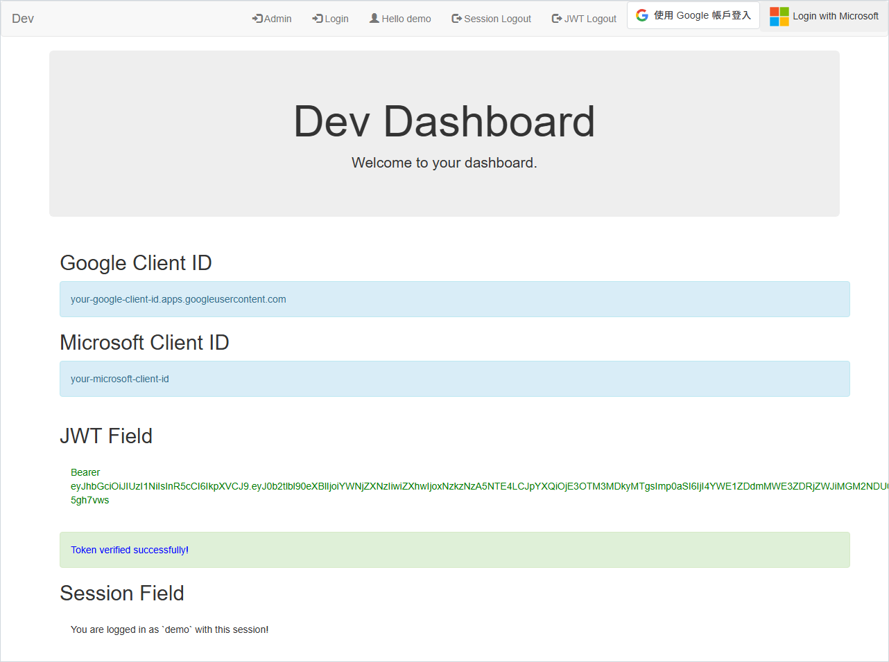
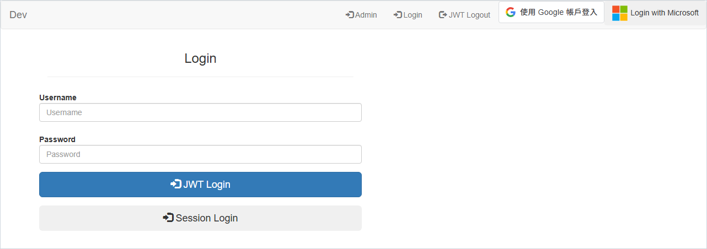

# Django Simple 3rd Party JWT Dev Dashboard

[](https://pypi.org/project/django-simple-third-party-jwt-dev-dashboard/)
[](https://pypi.org/project/django-simple-third-party-jwt-dev-dashboard/)
[](https://www.djangoproject.com/)
[](https://github.com/NatLee/django-simple-3rd-party-jwt-dev-dashboard/actions/workflows/test.yml)
[](https://github.com/NatLee/django-simple-3rd-party-jwt-dev-dashboard/blob/main/LICENSE)

A hidden developer page for your Django project's login. Sign in with a username and password (as a
session or as a JWT), with Google, or with Microsoft, and watch the dashboard refresh and verify the
token, before you have written a single line of frontend. It is the companion of
[django-simple-3rd-party-jwt](https://github.com/NatLee/django-simple-3rd-party-jwt), which does the
actual "Google / Microsoft account → JWT" work.



> **Development only.** The dashboard shows your OAuth client IDs, its login view skips CSRF checks,
> and it keeps tokens in the browser's `localStorage`. Mount it on a hidden URL and keep it out of
> production, for example by adding its routes only when `DEBUG` is on.

## What you can try

| Try this | How | Served by |
|---|---|---|
| Session login and logout | **Session Login** on the login page, **Session Logout** in the navbar | this dashboard |
| JWT login | **JWT Login** on the login page; the tokens are kept in `localStorage` | Simple JWT |
| Refresh and verify | every dashboard visit refreshes the stored token and verifies the new one | Simple JWT |
| Google login | the **Sign in with Google** button | django-simple-3rd-party-jwt |
| Microsoft login | **Login with Microsoft**, which comes back with a JWT | django-simple-3rd-party-jwt |
| JWT logout | **JWT Logout** forgets the stored tokens | your browser |
| Admin, Swagger, Redoc | navbar links, shown when you configure their URLs | Django admin, drf-yasg |



## How it fits with django-simple-3rd-party-jwt

This package only brings pages. The work happens in two other places:

- [Simple JWT](https://django-rest-framework-simplejwt.readthedocs.io/) issues, refreshes and verifies
  tokens for username and password logins. You add its three views to your `urls.py`.
- [django-simple-3rd-party-jwt](https://github.com/NatLee/django-simple-3rd-party-jwt) turns a Google
  credential or a Microsoft sign-in into the same kind of token pair. It serves
  `/<JWT_3RD_PREFIX>/auth/google/token` and `/<JWT_3RD_PREFIX>/auth/microsoft/...`.

The dashboard is a set of buttons wired to those URLs, so you can see the whole flow working in your
project. The pages load jQuery, Bootstrap 3 and Google's Sign-In script from CDNs, so the browser needs
internet access.

## Installation

```bash
pip install django-simple-third-party-jwt-dev-dashboard
```

Needs Python 3.8+ and Django 4.0+. It also installs Django REST framework, django-simple-third-party-jwt
(which brings Simple JWT), django-bootstrap3 and drf-yasg.

## Quick start

**1. Add the apps** in `settings.py`:

```python
INSTALLED_APPS += [
    "rest_framework",
    "bootstrap3",
    "django_simple_third_party_jwt",  # Google and Microsoft login
    "django_simple_third_party_jwt_dev_dashboard",  # this dashboard
]
```

**2. Tell the dashboard where things live**, also in `settings.py`:

```python
DEV_DASHBOARD_SETTINGS = {
    "jwt_token_url": "api/auth/token",
    "jwt_refresh_url": "api/auth/token/refresh",
    "jwt_verify_url": "api/auth/token/verify",
    "dashboard_url": "api/__hidden_dev_dashboard",
    "admin_url": "api/__hidden_admin",
}

# Required by django-simple-third-party-jwt: the URL prefix of its Google and Microsoft routes.
# Keep it non-empty; the dashboard links to /<prefix>/auth/...
JWT_3RD_PREFIX = "api"

# Where a Microsoft login lands afterwards
LOGIN_REDIRECT_URL = "/" + DEV_DASHBOARD_SETTINGS["dashboard_url"]

# Let the Google Sign-In popup talk back to the page
SECURE_REFERRER_POLICY = "no-referrer-when-downgrade"
SECURE_CROSS_ORIGIN_OPENER_POLICY = None
```

**3. Add the routes** to the project's `urls.py`. A new project's `urls.py` already imports `admin`
and `path`. Remove its default `admin/` route: the admin moves to the hidden URL, and Django would
otherwise warn that the admin is mounted twice (`urls.W005`).

```python
from django.conf import settings
from django.urls import include
from rest_framework_simplejwt.views import TokenObtainPairView, TokenRefreshView, TokenVerifyView

dashboard_urls = settings.DEV_DASHBOARD_SETTINGS

urlpatterns += [
    # Google and Microsoft login (django-simple-third-party-jwt)
    path("", include("django_simple_third_party_jwt.urls")),
    # The dashboard and the admin
    path(dashboard_urls["dashboard_url"] + "/", include("django_simple_third_party_jwt_dev_dashboard.urls")),
    path(dashboard_urls["admin_url"] + "/", admin.site.urls),
    # Simple JWT, called by the dashboard's JavaScript
    path(dashboard_urls["jwt_token_url"], TokenObtainPairView.as_view(), name="token_get"),
    path(dashboard_urls["jwt_refresh_url"], TokenRefreshView.as_view(), name="token_refresh"),
    path(dashboard_urls["jwt_verify_url"], TokenVerifyView.as_view(), name="token_verify"),
]
```

**4. Run it:**

```bash
python manage.py migrate
python manage.py createsuperuser
python manage.py runserver 0.0.0.0:8000
```

Open <http://localhost:8000/api/__hidden_dev_dashboard/> and log in with the user you just created.
Username and password logins work right away; Google and Microsoft need the settings below.

## Settings

### `DEV_DASHBOARD_SETTINGS`

Paths without a leading slash. The dashboard only links to them or calls them from JavaScript; you
add the matching routes in `urls.py`.

| Key | What uses it | Quick start value |
|---|---|---|
| `dashboard_url` | the dashboard itself, its login and logout | `api/__hidden_dev_dashboard` |
| `jwt_token_url` | the **JWT Login** button | `api/auth/token` |
| `jwt_refresh_url` | the token refresh on every dashboard visit | `api/auth/token/refresh` |
| `jwt_verify_url` | the token check after each login or refresh | `api/auth/token/verify` |
| `admin_url` | the **Admin** link | `api/__hidden_admin` |
| `swagger_url` | the **Swagger** link, optional | not set |
| `redoc_url` | the **Redoc** link, optional | not set |

A link whose key is missing is hidden. If you leave out `DEV_DASHBOARD_SETTINGS` altogether, the
dashboard uses the quick start values plus `api/__hidden_swagger` and `api/__hidden_redoc`.

### Google and Microsoft login

These settings belong to django-simple-3rd-party-jwt; the dashboard reads the client IDs to show them
and to set up the Google button.

```python
import os

SOCIAL_GOOGLE_CLIENT_ID = "<your-client-id>.apps.googleusercontent.com"
SOCIAL_MICROSOFT_CLIENT_ID = "<your-application-client-id>"
# Never commit a client secret: read it from the environment
SOCIAL_MICROSOFT_CLIENT_SECRET = os.environ["SOCIAL_MICROSOFT_CLIENT_SECRET"]

# E-mail domains that may sign up through Google or Microsoft
VALID_REGISTER_DOMAINS = ["gmail.com", "hotmail.com"]
```

Without them, django-simple-3rd-party-jwt falls back to its author's demo apps and logs a warning.
Those may stop working at any time, so register your own:

<details>
<summary><b>Get a Google client ID</b></summary>

1. Open [Google Cloud → APIs & Services → Credentials](https://console.cloud.google.com/apis/credentials)
   and create an **OAuth client ID** of type **Web application**.
2. Add `http://localhost` and `http://localhost:8000` to **Authorized JavaScript origins** and to
   **Authorized redirect URIs**.
3. Put the client ID in `SOCIAL_GOOGLE_CLIENT_ID`.

</details>

<details>
<summary><b>Get a Microsoft client ID and secret</b></summary>

1. Open [Microsoft Entra ID → App registrations](https://portal.azure.com/#view/Microsoft_AAD_IAM/ActiveDirectoryMenuBlade/~/RegisteredApps)
   and register a new application. For "Supported account types", pick the option that includes
   personal Microsoft accounts if you want those to work.
2. Add a **Web** redirect URI: `http://localhost:8000/api/auth/microsoft/callback`
   (`api` is your `JWT_3RD_PREFIX`).
3. Copy the **Application (client) ID** from the **Overview** page into `SOCIAL_MICROSOFT_CLIENT_ID`.
4. Under **Certificates & secrets**, create a client secret and copy its **Value** (Azure shows it
   only once) into the `SOCIAL_MICROSOFT_CLIENT_SECRET` environment variable.

</details>

### Optional extras

<details>
<summary><b>Swagger and Redoc links</b> (drf-yasg)</summary>

drf-yasg is installed with this package. Add `"drf_yasg"` to `INSTALLED_APPS`, add the two URLs to
`DEV_DASHBOARD_SETTINGS`, and serve the pages in `urls.py`:

```python
# settings.py
DEV_DASHBOARD_SETTINGS["swagger_url"] = "api/__hidden_swagger"
DEV_DASHBOARD_SETTINGS["redoc_url"] = "api/__hidden_redoc"
SWAGGER_USE_COMPAT_RENDERERS = False
```

```python
# urls.py
from drf_yasg import openapi
from drf_yasg.views import get_schema_view
from rest_framework.permissions import AllowAny

schema_view = get_schema_view(
    openapi.Info(title="DEV DASHBOARD API", default_version="v1"),
    public=True,
    permission_classes=(AllowAny,),
)
urlpatterns += [
    path(dashboard_urls["swagger_url"] + "/", schema_view.with_ui("swagger", cache_timeout=0), name="schema-swagger-ui"),
    path(dashboard_urls["redoc_url"] + "/", schema_view.with_ui("redoc", cache_timeout=0), name="schema-redoc"),
]
```

</details>

<details>
<summary><b>Token lifetimes</b> (Simple JWT)</summary>

```python
from datetime import timedelta

SIMPLE_JWT = {
    "ACCESS_TOKEN_LIFETIME": timedelta(minutes=60),
    "REFRESH_TOKEN_LIFETIME": timedelta(days=1),
    "AUTH_HEADER_TYPES": ("Bearer",),
}
```

All options are in the [Simple JWT settings](https://django-rest-framework-simplejwt.readthedocs.io/en/latest/settings.html).
To call these APIs from a frontend on another origin you also need CORS headers, for example with
[django-cors-headers](https://github.com/adamchainz/django-cors-headers).

</details>

## Example project

[`example/`](https://github.com/NatLee/django-simple-3rd-party-jwt-dev-dashboard/tree/main/example/django_simple_third_party_jwt_dev_dashboard_example)
is a small Django project set up exactly like the quick start:

```bash
git clone https://github.com/NatLee/django-simple-3rd-party-jwt-dev-dashboard.git
cd django-simple-3rd-party-jwt-dev-dashboard/example/django_simple_third_party_jwt_dev_dashboard_example
pip install -r requirements.txt
python manage.py migrate
python manage.py createsuperuser
python manage.py runserver 0.0.0.0:8000
```

Then open <http://localhost:8000/api/__hidden_dev_dashboard/>. To try your own Google or Microsoft
app, export its values before `runserver`; anything you leave unset falls back to the demo apps:

```bash
export SOCIAL_GOOGLE_CLIENT_ID="<your-client-id>.apps.googleusercontent.com"
export SOCIAL_MICROSOFT_CLIENT_ID="<your-application-client-id>"
export SOCIAL_MICROSOFT_CLIENT_SECRET="<your-client-secret>"
```

`requirements.txt` installs the dashboard from PyPI. To run the example against your local checkout
instead, run `pip install -e ../..` afterwards.

## Development

```bash
git clone https://github.com/NatLee/django-simple-3rd-party-jwt-dev-dashboard.git
cd django-simple-3rd-party-jwt-dev-dashboard
pip install tox
tox -e py
```

`tox -e py` checks the package manifest and runs the tests with pytest. For a quicker loop, run
`pip install -e . pytest pytest-django` once and then `pytest tests`. The tests use
`tests/settings.py`, which follows the quick start, and run against the django-simple-third-party-jwt
release on PyPI. CI runs them on Python 3.8 to 3.14, on the oldest supported Django (4.0), and also
builds and checks the package.

```text
src/django_simple_third_party_jwt_dev_dashboard/
    views.py       the dashboard page, session login and logout
    settings.py    DEV_DASHBOARD_SETTINGS and its defaults
    templates/     base.html (navbar and shared JavaScript), dashboard.html, login.html
example/           the runnable example project
tests/             the test suite; tests/settings.py mirrors the quick start
docs/images/       README screenshots
```

`dev-reinstall.sh` (or `dev-reinstall.ps1` on Windows) rebuilds the sdist and reinstalls it into the
current environment.

## License

[MIT](https://github.com/NatLee/django-simple-3rd-party-jwt-dev-dashboard/blob/main/LICENSE)
